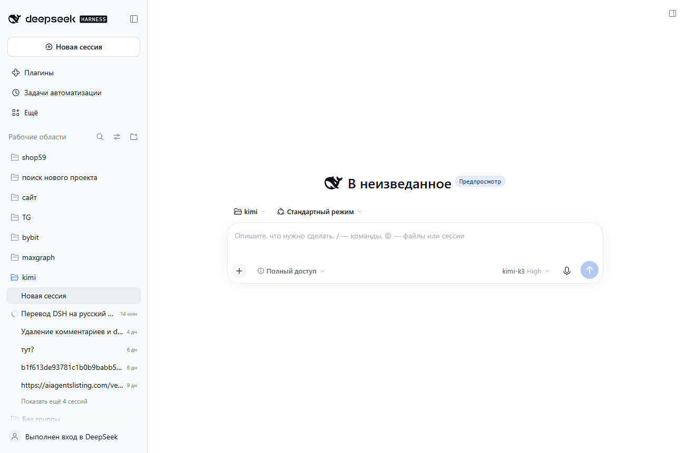
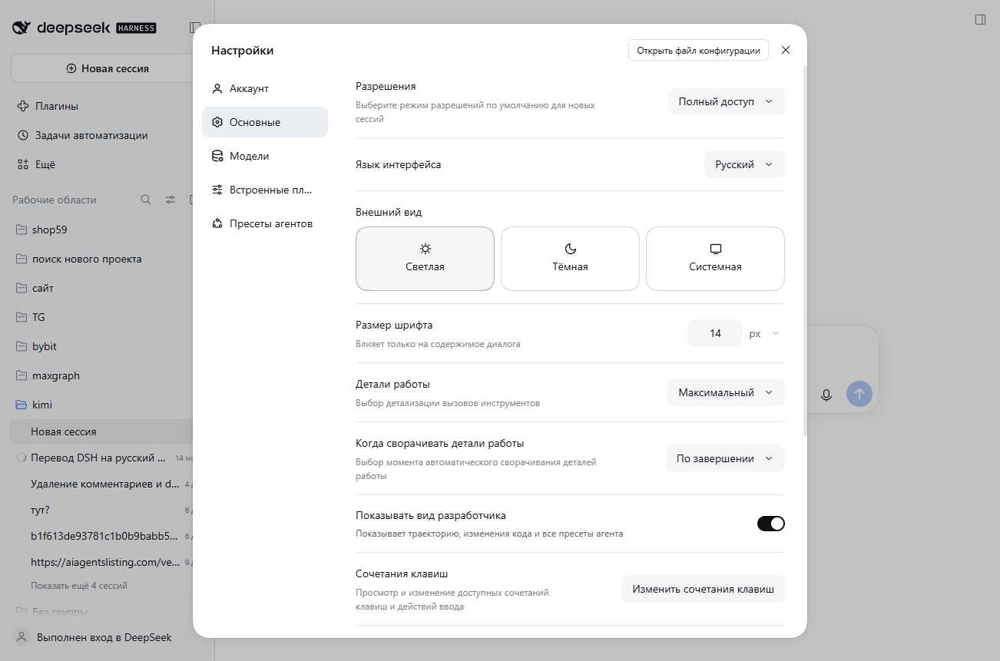
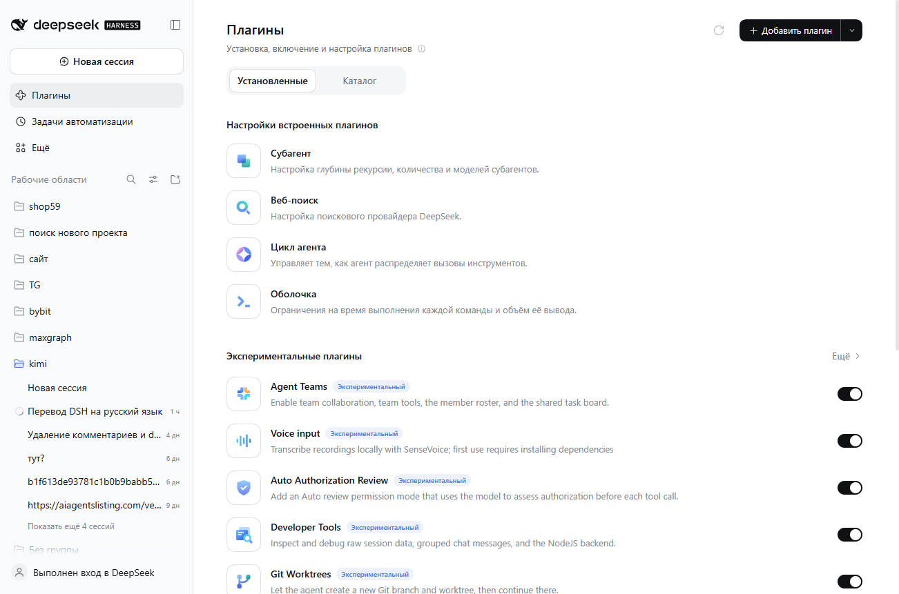

# DeepSeek Harness — Русский языковой пакет (неофициальный)

> **Unofficial community package.** Не является продуктом DeepSeek. DeepSeek Harness — [github.com/deepseek-ai/deepseek-harness](https://github.com/deepseek-ai/deepseek-harness).

Полная русская локализация веб-интерфейса DeepSeek Harness: **65 неймспейсов, 2915 строк** — все экраны, настройки, плагины, сочетания клавиш, планировщик, субагенты, пресеты и т.д.





## Установка

1. Откройте DSH → **Плагины** → **Добавить плагин**.
2. Вставьте адрес репозитория: `https://github.com/RuMemory/deepseek-harness-ru`
3. **Настройки → Основные → Язык интерфейса → Русский.**

Готово. Без перезапуска, без патчей установки — пакет ставится как обычный плагин и переживает обновления DSH.

## Как это работает

DSH имеет штатную систему локалей (`@deepseek-ai/dsh-client-locale`) с поддержкой внешних языковых пакетов: пакет регистрирует язык через `ctx.locale.addLanguage({ id: "ru", fallback: "en" })` и словари через `ctx.locale.register(ns, "ru", dict)`. Непереведённое автоматически показывается на английском — ничего не ломается.

## Ограничения

- **CLI не переведён** — в нём нет системы локализации, перевод возможен только патчем `app.asar`, который затрётся обновлением.
- **Описания экспериментальных комплектов** на странице «Плагины» берутся из метаданных пакетов (LocalizedText), а не из словарей — у штатных пакетов нет русской меты, поэтому они остаются английскими.

## Разработка и обновление перевода

```
tools/extract-locale-dicts.mjs   # извлечь en/zh словари из app.asar DSH
tools/export-en-json.mjs         # эталонные en JSON
tools/check-ru.mjs <ns...>       # валидатор: парсинг, паритет ключей, плейсхолдеры
tools/build-client.mjs           # сборка lib/client.js + отчёт покрытия
```

- `ru/<namespace>.js` — переводы (источник истины)
- `en-json/<namespace>.json` — английский эталон для diff при обновлениях DSH
- `GLOSSARY.md` — глоссарий терминов (единая терминология)
- `lib/client.js` — сгенерированный бандл, коммитится

После обновления DSH: извлечь словари заново, сравнить с `en-json/`, доперевести новые ключи, пересобрать.

## Лицензия

MIT. Строки интерфейса извлечены из DeepSeek Harness (MIT).

---

# DeepSeek Harness — Russian Language Pack (unofficial)

> **Unofficial community package.** Not affiliated with DeepSeek.

Complete Russian localization of the DeepSeek Harness web GUI: **65 namespaces, 2,915 strings** — every screen, settings, plugins, shortcuts, scheduler, subagents, presets.

## Install

1. Open DSH → **Plugins** → **Add plugin**.
2. Paste this repository URL: `https://github.com/RuMemory/deepseek-harness-ru`
3. **Settings → General → Language → Русский.**

No patching, survives DSH updates. Built on the official locale API (`dsh-client-locale`): the pack registers `ru` via `addLanguage` and contributes dictionaries per namespace; untranslated keys fall back to English.

## Known limits

- CLI is not translated (no i18n support there).
- Experimental bundle descriptions on the Plugins page come from package metadata, not dictionaries, so they stay in English.

## License

MIT. UI strings are derived from DeepSeek Harness (MIT).

---

Built by [RuMemory](https://github.com/RuMemory) — authors of [maxgraph](https://github.com/RuMemory/maxgraph), graph memory for AI agents.
